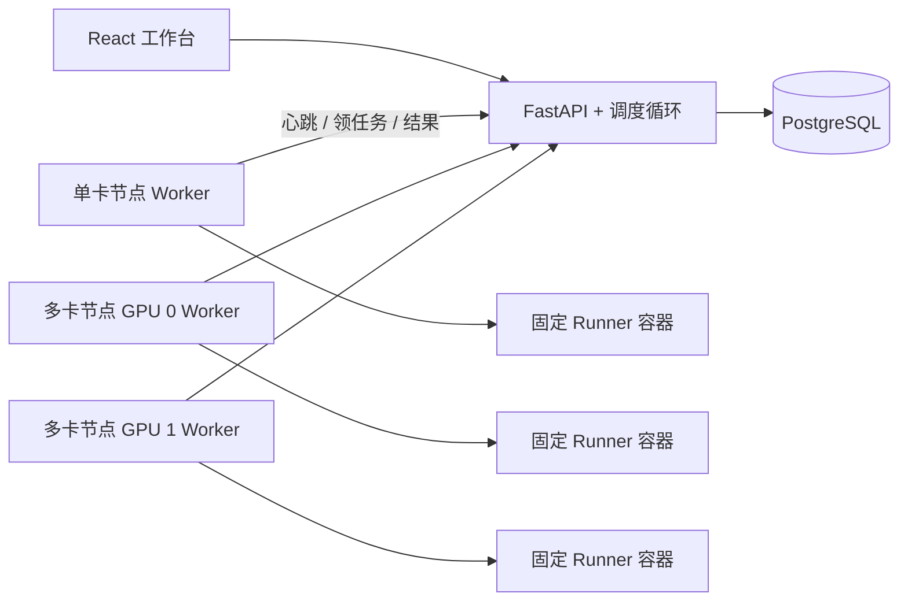

# 架构与执行协议

API 容器内运行调度循环。每次循环通过 PostgreSQL transaction advisory lock 取得领导权；多 API 实例可同时启动，但只有一个事务能执行分配。取消、认领、续租、结果等状态写入使用同一事务锁。数据库部分唯一索引再次约束每张槽位只能有一个活动尝试。

## 准入

提交只写 PENDING Job 和 Run。调度器持久化用户轮转游标，用户间轮转、每用户按提交时间选择最早可调度任务。不可满足资源需求的任务不会阻塞其他可调度请求。计入额度的状态包括 RESERVED、STARTING、RUNNING、CANCEL_REQUESTED，以及所有尚未确认容器停止的终态尝试。

每 GPU UUID 唯一注册一个槽位；同一机器的 GPU 编号也唯一。注册时核对资源池的 GPU 型号和最低显存。调度只选择在线、启用、未隔离的槽位，核对全局/用户并发、机器并发及 CPU/内存总额度。额度由管理员按机器可分配资源配置，不会自动推测其他容器的资源需求。

## 执行与恢复

- RESERVED 尚未被认领时，过期可以安全退回 PENDING；此时 Worker 尚未获得执行权。
- 认领后进入 STARTING，获得固定 execution ID 和租约。重复认领返回同一 execution ID。
- 容器名由 execution ID 构成。创建意图先写本机执行记录，再创建容器。重启后先检查原容器；存在不确定创建记录但容器丢失时直接失败，不重新执行。
- Worker 续租后进入 RUNNING。独立 watchdog 在租约到期时停止容器；Runner 内另有进程监督器限制总运行时长。
- 心跳丢失先停止新准入。超过租约和失联宽限期后，服务端把任务标成 TIMED_OUT 并隔离槽位。旧容器尚未确认停止时，禁止重试。
- Worker 重连后停止旧容器并发送 cleanup 确认，服务端才解除隔离。即使旧 Worker 返回成功，也不能覆盖已经结束的尝试。
- 正常停止 Worker 会尝试停止容器并确认清理；SIGKILL、机器掉电等由租约和重连协议处理。
- 重试生成新 Run/attempt/execution ID，旧日志和指标保留。

协议优先避免不确定状态下重复执行。整个机器永久丢失时，槽位保持隔离；需要恢复该 Worker 或人工确认旧执行已停止后处理，不能直接自动复用。

## 日志、身份和边界

Worker 凭据为独立随机 token，数据库只存 SHA-256 摘要；用户 JWT 不能调用 Worker 协议。日志按 `(run_id, sequence)` 幂等写入，单批最多 8192 字符，每次尝试最多 256 KiB；用户只可读取自己的任务，管理员可读取全部。

用户只提交白名单评测参数。镜像由管理员配置，Worker 再核对本地许可镜像；Docker 命令由程序构造，不接受用户的镜像、命令、挂载或特权参数。Worker 需要 Docker 权限，应运行在受信任的评测机器上。V1 每任务使用一张 GPU，不支持单任务多卡、GPU 显存分片或抢占。
