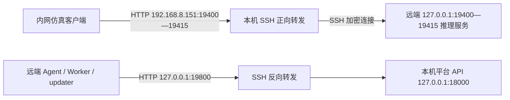

# 昇腾公网服务端接入

节点 `ascend910b3-29`（1.95.69.29）以 **server** 角色纳管。Agent 监测 8 张 910B3；8 个系统级 Worker 分别持有设备身份，独立 updater 管理完整代码升级。资源池“Ascend 910B3 服务端资源”仅包含 NPU 2、3，其余六张卡保持未分配，不会接收平台任务。现有业务和驱动不修改。

## 网络

本机没有远端可直连的 API 地址，由本机主动建立 SSH 连接：



本机用户服务：`mini-eval-ascend29-tunnel.service`；启用开机启动及失败自动重连，15 秒保活、连续 3 次失败断开。已有 SSH known_hosts 严格校验，使用 `/home/dgh/29.kem`，不保存密码。连接复用 socket 位于用户私有 `/run/user/1001/`。

API 的远端入口只绑定 loopback；推理转发只绑定本机 LAN 地址，不新增公网 API 监听。平台服务网络配置：

```json
{"address":"192.168.8.151","bind_address":"127.0.0.1","port_start":19400,"port_end":19415}
```

`address` 提供给客户端，`bind_address` 用于远端程序监听和 Worker 健康检查。未填监听地址时沿用可达地址，旧配置兼容。每个转发端口在本机和远端使用相同编号；更改端口范围时同时修改隧道。独立部署只有地址与端口匹配此配置范围时才套用本地监听地址。当前执行使用提交时固化的绑定，不受后续配置编辑影响。

## 节点布局与权限

| 用途 | 位置 |
| --- | --- |
| Worker / SDK / Agent 发布代码 | `/opt/mini-eval-node/app` |
| 批准的宿主机业务目录 | `/opt/mini-eval-node/business` |
| 私密 Worker 配置 | `/etc/mini-eval-node/npu0.json` 至 `npu7.json` |
| 私有恢复状态 | `/var/lib/mini-eval-node/state` |
| 各卡工作目录 | `/var/lib/mini-eval-node/work/npuN` |
| 资产 / 缓存 | `/var/lib/mini-eval-node/assets`、`/var/lib/mini-eval-node/cache` |
| 独立升级器 | `/opt/mini-eval-updater` |

批准的宿主机环境名 `ascend_cann`，解释器 `/mnt/sfs_turbo/lianjie/runtimes/lingbot-cloud/bin/python3.12`。控制进程使用系统服务权限；宿主机业务使用 `HwHiAiUser`，只能打开分配的计算设备。业务启动文件和输出放在任务执行目录，Worker 状态与凭据保持私有，不能通过放宽私密目录权限解决启动问题。普通 GPU 宿主机保持原用户级执行方式；旧执行句柄保留恢复兼容性。

Worker 0.13.1 / 协议 11，Agent 1.1.0。此处为管理员显式批准的系统级 NPU 安装；现有 SSH 纳管向导的自动硬件检查仍偏向 NVIDIA，不应把本次部署当作向导已支持所有 NPU 环境。代码升级通过平台节点升级功能完成并已实测。

## 操作

- 平台：管理设置 → 机器管理 → 服务端机器 → `ascend910b3-29`。
- 新建服务或提交编排时选择 NPU 服务模板及上述资源池；客户端继续选择 GPU 资源池。平台分配服务地址，业务无需自行选择隧道端口。
- 本机查看连接：`systemctl --user status mini-eval-ascend29-tunnel.service`。
- 远端查看组件：`systemctl status mini-eval-agent mini-eval-updater mini-eval-worker-npu2`。
- 停用节点会阻止新的调度；先等待持有执行清理完成，再调整组件或移除纳管。不要删除恢复状态来强行释放资源。
- 隧道中断时客户端访问和节点心跳都会受影响；自动重连后由租约和恢复账本决定执行状态，不能仅看到 systemd 活跃就视作任务成功。

[ACL HTTP 示例](../examples/ascend_service/README.md) 验证实际设备分配和平台链路，不是模型推理质量评测。

## 本次验收与发布

宿主机服务和容器服务各完成一个三任务编排批次，共 6 个客户端任务、12 个回合成功；观察到任务排队后推进，同时有两个健康服务。客户端分布在多个内网 GPU 节点，自动获得转发地址。宿主机双服务同卡共享、host/docker 同卡共存、停止单个服务不影响另一服务均通过。主动重启 SSH 隧道后 1.33 秒恢复，两项存活服务保持原执行 ID。最终节点在线、8 个 Worker 在线、持有执行为 0，验证服务全部停止且清理确认。

服务/编排/恢复回归 29 通过、12 跳过（可选实机恢复用例）；宿主机/设备/限额回归 29 通过；前端相关浏览器回归 5 通过，TypeScript/Vite 构建通过。实机结果见 [验收证据](validation/template-resource-requirements/npu-enrollment.json)。这些是本次变更的专项回归，上一轮全量测试记录保留在同目录 README。

当前 API 镜像标签 `mini-eval-api:npu-host-fix-20261116`，部署覆盖文件 `.runtime/npu-enrollment/release-host-fix/image.yml`；数据库版本仍为 `s952b34`。NPU Worker 经平台升级至 0.13.1，已有五个 GPU Worker 保持兼容的 0.13.0。

平台已保留“Ascend 服务联通客户端”、宿主机及容器两个“Ascend ACL HTTP 验证服务”模板，以及“NPU 服务端联通验证（三任务）”集合，可用于重新发起验证。首次宿主机运行发现私有状态目录不可供业务用户遍历，已修复为独立任务目录，不放宽私密状态目录；失败记录保留供追溯。
