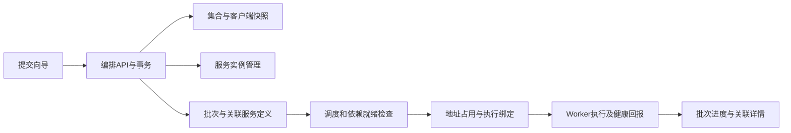

# Design

## Context

现有`frontend/src/run-wizard.tsx`提供四步流程：集合、客户端与外部地址、资源、预检。只支持临时清单或已发布集合；`batches.py`原子创建客户端任务，但不创建服务。`services.py`部署仅供管理员使用，需要用户指定slot、IPv4和端口。`endpoints.py`负责地址互斥和分配；`Run`已保存地址和模式，没有关联服务执行标识。调度与领取使用数据库锁，Worker服务健康报告约15秒有效。

`runner/parameter_contract.py`已有类型、默认值、覆盖白名单、argv/env/input映射，必须复用并扩展；不新造另一套类型系统。当前`cs_entry`强制探测endpoint，Worker非服务成功判定要求final评测数据，尚不能直接充当普通批处理入口。本变更按用户补充要求加入普通命令接入，必须同步调整任务类型和结果契约，不能只在界面隐藏服务地址。

`services.py`当前路由内包含创建逻辑及commit，不能直接串调路由实现事务。`batches.py`的旧幂等逻辑没有请求摘要，新增编排入口必须强化而不擅自改写旧批次的兼容语义。固定用户/全局/节点并发配额仍然生效，常驻服务会消耗这些配额。

## Goals / Non-Goals

**Goals:** 在现有API、调度器和Worker上增加一个边界明确的编排模块；对集合快照、服务依赖、每次执行绑定和生命周期负责。复用服务模板、资源账本、端点互斥和清理协议。

**Non-Goals:** 不新增推理服务池；不实现Kubernetes、通用DAG或自动扩缩容；不把NPU采集当成NPU执行支持；不在本变更取消现有并发配额。外部服务没有平台健康报告，继续依靠客户端通信预检，不声称已验证实际模型能力。

## Decisions

### 1. 向导扩展和模块边界

扩展现有运行入口，避免再建一个相似页面。步骤为：①选择/创建集合；②客户端模板及业务参数；③服务来源、服务端模板及业务参数；④期望并发和资源偏好；⑤预检与确认。模板提供合理资源默认值，用户可调整；节点、端口及映射配置不进入正常提交流程。将服务配置和提交摘要拆成组件，保留既有草稿及请求序号机制。字段编辑使旧预检失效；迟到的响应不能覆盖新配置；点击提交后网络失败重试保留原幂等键。

模块关系：



前端不依次调用“创建集合→部署服务→创建批次”，以免中途失败遗留资源。后端提取无commit的服务/批次创建函数，编排层拥有事务；原API路由继续调用相同函数并自行commit。避免编排层复制模板校验、参数解析和端口占用规则。

### 2. 提交契约及数据

新入口`POST /api/v1/orchestrations/preflight`和`POST /api/v1/orchestrations`接收：

- 集合：已有suite_id、新集合元数据+cases，或临时cases，三选一。
- 客户端：template_id、业务参数/覆盖、环境变量、超时，以及pool_id、GPU模式、显存需求、型号和max_concurrent。
- 服务来源：`none`用于无需服务的普通批处理，`external`地址列表，或`managed`服务定义。一次运行选择一种来源，多个地址/服务各自设置exclusive/shared。普通用户选择一个服务端模板及业务参数即可；平台生成默认逻辑引用并绑定全部case。高级配置允许多个业务服务定义和case候选引用，逻辑key不要求普通用户填写。这只是本次运行的对应关系，不创建服务池。托管服务声明模板、资源范围及申请，目标slot与端口由调度产生，可选高级固定约束。
- 托管服务结束策略：`stop_after_batch`或`keep_running`，默认前者。

保留当前清单最多100项和地址最多100项约束；托管实例首期上限20并做总请求大小校验。共享默认一个实例；独占按客户端并发目标按需启动实例，最多达到该目标及实例上限，资源不足时排队而不要求用户手填副本数。高级配置可限制副本上限。节点的客户端可达地址和允许服务端口范围属于管理员纳管配置，调度在选定节点后事务化分配端口；Worker实际bind失败时报告冲突并按有界重试策略重新分配，不能把数据库预留等同于操作系统bind。外部服务地址仍由用户提供。

新增编排记录，与EvaluationBatch一对一，归属沿用batch.owner_id，包含归一化请求摘要、配置快照和生命周期策略；关联服务记录保存配置键、service_instance_id、访问模式和自动停止状态。服务定义与部署实例分离，未调度定义没有虚构的slot/地址；ServiceInstance的具体节点和端口在资源选择后生成。联合预留直接复用两条Run记录，客户端Run标记waiting_service，避免增加另一套资源计数或双扣。Run增加可空的assigned_service_instance_id及assigned_service_execution_id，原地址/模式继续保留。对外部服务这两个字段为空。历史使用快照，不能通过当前ServiceInstance.current_job_id反推旧执行。

### 3. 提交事务与权限

在现有调度锁及用户锁下做完整校验，生成所有对象后一次提交。幂等键按用户隔离，并比较规范化请求摘要；同键不同内容返回409。相同请求重放先查原记录，避免后续模板停用导致已成功请求无法恢复结果。预检只读、不flush，不发网络探测。

普通用户通过新的最小只读选项接口获取可使用的服务模板和服务端slot，不能调用admin路由。给服务模板增加明确的普通用户可用标记，迁移默认关闭以保持原管理员部署边界；管理员可开启。机器仍须启用server角色、slot在有效资源池且执行环境已批准。用户可控制/看日志的关联服务必须经其编排归属校验；管理员保留全局管理权限。旧管理员创建实例仍按旧权限规则处理。

### 4. 服务依赖与绑定

客户端任务初始PENDING。首次启动服务前，调度器在同一事务中规划服务与至少一个等待客户端的联合资源预留，包括全局/用户/节点信用、CPU/RAM和设备内存；满足后才创建具体服务实例及启动执行。客户端预算预留不等于立即向Worker派发客户端，服务启动窗口内有明确过期时间，健康后转为普通客户端执行预留；服务失败或启动超时则释放尚未使用的客户端预留，服务自身预算直到清理确认才释放。数据库账本必须避免联合预留与Run预留双扣。已有健康共享服务允许复用，后续仅申请客户端资源。独占副本按需求及可同时满足的两端资源逐步创建，不预先把所有机器占满。

候选服务只有在当前服务执行RUNNING、desired_running、节点在线、健康报告新鲜且ready时参与选择。调度器消费Worker已有健康快照，不能自己访问服务地址。联合预留参与现有公平轮转，不允许一批次长期预留全部资源；等待健康的客户端预留受启动超时约束，暂停/取消前尚未启动服务的联合预留一并撤销。

在同一数据库锁内选择可用候选地址，应用现有host+port互斥规则，写入Run的地址、访问模式、服务实例和服务执行ID，再预留客户端资源。领取前重新检查绑定服务执行仍为当前且健康，防止预检/调度与领取之间服务失效。运行中的客户端不静默切换服务；服务失败时保留绑定、提示异常，客户端按协议失败或超时，显式重试可重新分配。

独占含义是“同一时刻一个客户端执行”，并非一个实例永久绑定一个任务；多个任务可串行复用。共享表示服务支持多客户端会话，并不意味着平台自动隔离业务会话或GPU显存。独占占用一直持续至执行清理确认；暂停撤销尚未领取的预留时同步清除尚未发生的绑定，历史已启动执行保持不变。

### 5. 生命周期与恢复

编排协调在现有调度tick内运行，所有动作依赖持久化状态并幂等。批次暂停保留服务，取消先停止客户端。选择自动停止时，只有全部客户端终态且cleanup_confirmed后才向服务发停止意图，服务资源继续由现有清理账本持有。选择保留时，详情持续显示服务占用和停止入口。平台不停止外部地址对应服务。

服务启动失败不无限自动重启：显示具体错误，允许归属用户在旧执行清理后显式重启。因批次自然结束而自动停止的服务，在用户重试客户端后可恢复启动；故障失败与主动停止不混同“自动停止”，避免违背用户停止意图。API和调度器重启通过记录恢复，不重复创建实例、服务执行或客户端尝试。

### 6. 预检、配额与可视化

复用DiagnosticContext，增加服务依赖及两端资源计划。与调度使用同一个纯资源规划器，检查全局/用户上限、节点CPU/RAM/并发、GPU独占和共享显存，验证至少一组服务+客户端可容纳，不要求一次容纳全部期望并发。仅对配置决定的不可满足状态阻止提交；其他任务暂占资源时可排队。不能把服务尚未创建判成地址无效。提交时再次校验，预检不预留资源。

确认页展示集合与总回合、两端模板版本/执行方式、期望并发与访问模式、资源申请及结束策略，托管地址端口显示“平台自动分配”，不要求用户填占位地址。进度页提供“任务→客户端节点→服务地址→服务实例/执行”的关系表，区分未分配、等服务启动、等健康、等地址释放、等机器资源、执行中。服务日志和历史通过归属API读取，查询批量化避免每个case重复扫描全部服务。

### 7. 参数所有权与解析顺序

参数必须有类型、来源、作用域和可覆盖规则，不能将所有值混入环境变量：

| 分类 | 来源与作用域 | 平台责任 | 程序获取方式 |
| --- | --- | --- | --- |
| 平台注入 | 每次执行的job/run ID、实际设备、分配地址、监听端口、解析后的工作/输出/资产路径 | 分配后生成，保留字段禁止业务覆盖；平台凭证不下发业务程序 | 统一输入platform段、受控环境变量或模板声明映射 |
| 集合任务定义 | 用户提供case_id、task_name、episodes、seed、服务引用 | 展开任务、生成回合计划、冻结版本；这些是用户声明的任务事实，不是平台随意生成的业务值 | 统一输入task段，兼容旧SDK字段 |
| 业务参数 | 客户端与服务端各自的parameter_schema、集合默认、case或服务实例配置 | 类型校验与白名单覆盖；不解释业务意义、不按参数名猜测资源需求 | business段或argv/env映射 |
| 运行配置 | 模板的宿主机环境/镜像、命令、允许覆盖变量、逻辑挂载 | 节点能力校验与逻辑路径解析，平台字段最终注入 | 执行器创建进程/容器 |
| 资源申请 | 批次默认、显式case覆盖、服务实例申请 | 校验CPU/RAM/设备内存等已有可支持资源并进入调度账本；未支持资源类型明确拒绝 | 统一输入中的实际分配只读信息 |

客户端业务解析顺序：模板默认 < 集合客户端默认 < case业务参数 < 本次运行显式覆盖；运行覆盖必须有overridable许可。服务端按“模板默认 < 逻辑服务定义 < 本次显式覆盖”解析，绝不把客户端case参数直接合并进共享服务配置。对象参数按字段整体替换，避免不透明的深合并；类型验证发生在每层输入和最终值上。表单显示最终值及来源，未知字段、保留键、重复argv/env目标、环境变量冲突均拒绝。

共享服务的模型路径、配置等启动参数是实例快照。若不同case需要不同模型或服务启动参数，用户定义不同逻辑服务key并显式绑定；不得在运行中的共享实例上逐case修改环境变量，也不按相似地址静默合并不同实例。纯逻辑集合可以声明服务引用键，具体地址/机器由运行时填写，集合不固定节点绝对路径。

资源申请只能来自结构化resources字段；例如业务参数batch_size=32不自动变成CPU/显存申请。每case资源覆盖若超出模板、资源池或用户策略则提交失败。当前支持能力必须明确展示，不能将NPU或任意CPU-only执行支持伪装成已有能力。调度快照冻结有效业务参数、两端模板版本和资源申请，分配阶段再补实际节点/设备/服务绑定，Worker不能重新解释用户覆盖顺序。

### 8. 用户程序的最小接入契约

提供标准库可读的JSON输入文件，由`MINI_EVAL_INPUT`指向，用户程序不需要平台账号、数据库、SSH权限或调度API。新版统一输入显式携带`input_version`，区分platform、task、business；SDK提供上下文读取辅助。保留旧CS contract_version与字段的兼容适配，不能直接改旧配置形状。模板声明所需契约和能力，旧Worker不领取不支持的新入口任务。

示例输入（结构设计，具体ID及路径由平台填充）：

```json
{
  "input_version": 1,
  "platform": {
    "job_id": "...", "execution_id": "...",
    "service": {"key": "policy-a", "endpoint": "ws://192.168.8.157:19093"},
    "paths": {"work": "/work", "output": "/output", "assets": {"robotwin": "/assets/robotwin"}}
  },
  "task": {"case_id": "case-001", "task_name": "pick_cube", "episodes": 10, "seed": 0},
  "business": {"camera": "front", "max_steps": 200}
}
```

三种接入层级共用同一输入和执行绑定：

1. **普通命令**：用户提供已有程序和模板映射，例如`--server`取platform.service.endpoint、`--task`取task.task_name、`--max-steps`取business.max_steps。参数通过argv数组传递，不拼shell；env映射限字符串，结构化值必须显式JSON编码。正常退出码决定执行成功，日志/输出目录自动收集；不要求final评测指标，不伪造回合进度。
2. **JSON输入/轻量SDK**：用户读取统一输入，按需报告阶段、指标和结果；SDK封装输入读取、字段校验及事件输出，Worker负责转发、重试与鉴权。SDK不向用户暴露平台管理令牌。
3. **逐回合评测**：沿用EvaluationClient或sdk-command，每回合提交success/metrics/artifacts，区分程序执行成功和业务目标成功率。业务目标未达成不自动等价于进程崩溃；缺失应有的回合报告按契约给出不完整结果。

任务类型与接入层级分开：普通批处理可使用SDK上报阶段但没有episode；CS评测必须配置服务；常驻服务使用ready/health与退出状态，不循环执行回合。服务端也可用argv/env获取平台分配的监听地址和端口，按模板提供TCP或HTTP健康探测，无需实现评测协议。宿主机和Docker采用相同输入语义，路径值由平台映射。提供三个最小样例及本地validate/dry-run命令，在未连接平台时可检查类型、参数映射和输出协议；正式运行仍须重新校验资源与权限。

### 9. 集合与模板的复制编辑

现有模板clone路由为管理员接口，已有typed schema保留测试；集合草稿编辑已有revision，但没有统一的用户复制入口。扩展这些能力，不在向导内复制不完整字段拼装对象。服务端模板新增owner_id（旧记录为空表示管理员管理）以及草稿状态和revision，客户端模板补齐相同草稿/版本语义；公开给成员使用与修改/发布为公共模板是不同权限。

集合、客户端模板、服务端模板提供归属校验的复制API。源可为用户拥有或明确允许使用的公共定义；新对象默认私有草稿，名称/版本唯一冲突返回409，复制保留业务schema、默认值、任务清单、模板引用、执行方式和允许的运行配置，但不继承凭证、节点授权、历史执行或公共发布权限。逻辑服务引用随集合复制，实际地址和运行绑定不进入可复用集合。

草稿编辑使用expected_revision并完整重新校验类型与映射；已发布定义采用复制/另存新版本后编辑。现有已发布对象维持可用，不强迫迁移后全部重建。参数删除或类型变更时校验集合case参数与新模板是否兼容，列出受影响字段；绝不静默丢弃业务值。用户拥有的服务器模板仍只能在已批准镜像/宿主机环境/逻辑挂载范围内执行，不能通过复制获得额外机器权限。

向导选择器内提供“复制并修改”，使用编辑面板保留原向导草稿；取消不替换原选择，保存发布成功才切换到新版本并使预检失效。公共模板的复制会生成自己的独立定义，后续源模板修改不传播到副本。提交时冻结实际使用版本及schema，任何后续编辑不改变已有运行输入或历史回合结果。

## Risks / Trade-offs

- [服务占满资源导致客户端永远排队] → 联合预检静态不可满足组合，运行中展示动态配额原因；不绕过现有资源账本。
- [跨机器地址可解析但不可达] → 配置预检明确不等于网络验证；可选单回合试跑验证两端实际通信，失败保留诊断。
- [健康回报与领取存在竞态] → 两阶段检查并绑定服务执行代次；执行中的业务失败由客户端报告，不承诺网络始终可用。
- [扩大成员权限] → 模板显式开放、默认关闭，按编排归属控制服务操作和日志，不开放admin接口。
- [服务退出或节点失联仍有残留进程] → 沿用cleanup_confirmed语义，不能以终态直接释放显存或地址占用。
- [请求参数含敏感信息] → 沿用模板变量白名单，选项接口不暴露节点文件路径/凭证；不在摘要和审计中写入原始敏感值。
- [多模块修改破坏旧路径] → 旧批次、地址列表、独立服务部署、控制/重试、报告导出均纳入回归。

## Migration Plan

1. 添加可空关联字段、编排与关联表、联合预留记录、节点服务地址/端口策略及服务模板成员可用标记；旧记录不回填虚构的服务关系。管理员先补齐服务节点可达地址与可用端口范围。
2. 先升级数据库及API/调度器，再发布向导；新编排依赖检查必须与创建入口同版本上线。CS入口复用现有客户端/服务协议，新增普通命令及统一输入能力通过Worker能力协商渐进升级；不把此次功能依赖于新Agent采集版本。
3. 使用隔离数据库执行升级、旧数据兼容、并发和回退测试；用测试模板/受控节点验证最小闭环后开放普通用户模板。
4. 回退前关闭新编排提交，排空/停止其客户端及服务并确认清理；不能直接用不认识依赖关系的旧调度器运行未结束编排。保留快照和绑定数据供诊断，数据库降级仅在确认无活动编排后进行。
